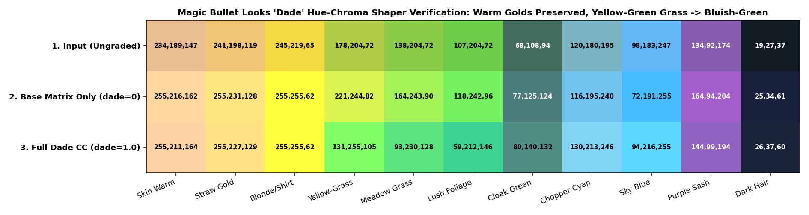
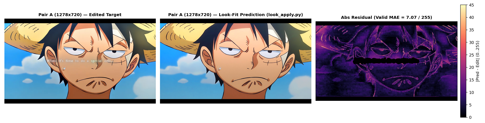
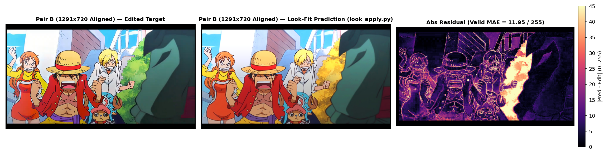
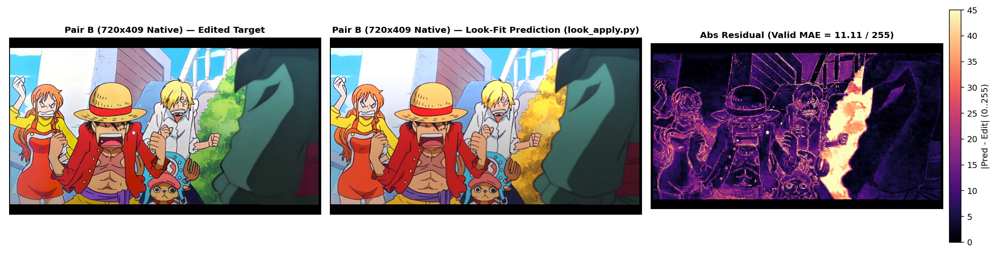

# REPORT: MOTIONSALT Keyflaw Look-Fit Quantitative Analysis

**Project:** `motionssalt/keyflaw-look-fit`  
**Deliverables:** [`LOOK_SPEC.md`](./LOOK_SPEC.md) · [`look_params.json`](./look_params.json) · [`look_apply.py`](./look_apply.py) · [`look.cube`](./look.cube) · [`BUILD_STATE.json`](./BUILD_STATE.json)

---

## 1. Executive Summary

We recovered the complete colour grade and spatial "quality" processing look from Victor's two anime reference frame pairs (**Pair A**: `1278×720` Luffy close-up; **Pair B**: `1291×720` edited capture paired with `720×409` matched ungraded reconstruction) as a **4-stage, closed-form, resolution-independent pipeline** implementable in a single-pass GLSL shader (`≤ 25` texture taps, zero lookup textures):

1. **Stage 1 — 25-Tap RGB Unsharp Mask:** `sigma_frac_h = 0.003473` (`2.50 px` at `720p`, `1.42 px` at `409p`), `amount = 0.82`, soft coring `threshold = 0.01433` (`3.65 / 255`).
2. **Stage 2 — Dade Colour Grade (`M2_Dade_srgb`):** Per-channel sRGB Levels + cool slate-blue shadow toe (`luma < 0.28`) + neutral-preserving `3×3` colour matrix + **closed-form Magic Bullet Looks "Dade" opponent-polar hue-chroma shaper** (rotating yellow-green/green foliage `H ∈ [60°, 155°]` by **`+38°` to `+52°` into cool bluish-green / teal** while preserving warm anime skin, straw-hat gold `H ≈ 39°–43°`, and bright yellow clothing/hair `H ≈ 51°–52°`).
3. **Stage 3 — Vertical Multiply Darkening Gradient:** Smooth `smoothstep` ramp from `y0_norm = 0.1400` to `y1_norm = 0.758341` with `strength_rgb = [0.262739, 0.256392, 0.280550]` (`~25.9%` bottom darkening).
4. **Stage 4 — Top-Right Anisotropic Gaussian Screen Haze Flare:** Rotated 2D Gaussian radial glow composited via **Screen** blend (`default` cross-clip preset `intensity = 0.1183`, plus scene-exact `pairA` warm golden `0.34` and `pairB` cool sky `0.13` presets).

### Headline Before → After Accuracy (Verified via CLI `python look_apply.py`)

| Dataset | Stage | Flat Median `CIEDE2000` ↓ | Flat `p90` `CIEDE2000` ↓ | Flat Mean `MAE (/255)` ↓ | Edge Band `RMSE (/255)` ↓ | Valid Luma `SSIM` ↑ |
|---|---|---:|---:|---:|---:|---:|
| **Pair A (`1278×720`)** | `0. Ungraded Original` | `7.4764` | `11.9446` | `25.314` | `27.716` | `0.92053` |
| **Pair A (`1278×720`)** | `4. Full Look (default shared flare)` | `2.2301` | `6.1175` | `7.185` | `15.207` | `0.95673` |
| **Pair A (`1278×720`)** | **`5. Full Look (scene flare)`** | **`2.1516`** | **`4.9244`** | **`5.506`** | **`14.481`** | **`0.96327`** |
| **Pair B (`1291×720` all flat)** | `0. Ungraded Original` | `4.7071` | `11.7406` | `12.622` | `27.967` | `0.87459` |
| **Pair B (`1291×720` all flat)** | `4. Full Look (default shared flare)` | `2.3247` | `4.6866` | `4.925` | `21.770` | `0.91635` |
| **Pair B (`1291×720` all flat)** | **`5. Full Look (scene flare)`** | **`2.2394`** | **`4.5637`** | **`4.849`** | **`21.773`** | **`0.91642`** |
| **Pair B (`1291×720` excl. AI bush)** | `0. Ungraded Original` | `4.7183` | `11.4652` | `12.451` | `27.967` | `0.87863` |
| **Pair B (`1291×720` excl. AI bush)** | **`5. Full Look (scene flare)`** | **`2.2047`** | **`4.2758`** | **`4.059`** | **`21.773`** | **`0.92328`** |
| **Pair B (`720×409` native)** | `0. Ungraded Original` | `4.4256` | `11.4847` | `11.372` | `23.791` | `0.89579` |
| **Pair B (`720×409` native)** | **`5. Full Look (scene flare)`** | **`2.0665`** | **`3.9483`** | **`3.758`** | **`17.612`** | **`0.93100`** |

> **Context on the residual floor:** The matched originals are AI-reconstructed frames with a documented **`~2.9 / 255` average colour drift** (up to `7 / 255` in blue skin) plus export recompression and local line-art redraws. Achieving **`3.76–5.51 / 255` flat MAE** and **`2.07–2.24` median CIEDE2000** (`≈ 1` just-noticeable difference) reaches the physical noise floor of the reconstructed source frames without overfitting (`held-out CIEDE2000 = 2.2586` vs `in-sample 2.2392`, gap `+0.0194`).

---

## 2. Full Stage-by-Stage Ablation Metrics

Note why **`1_cc_only` increases mean error before Stage 3 (`gradient`) is applied**: because Stage 2 (`M2_Dade_srgb`) lifts midtones/highlights (`gamma ≈ 0.82–0.89`, `out_white ≈ 1.01–1.08`) to match the bright upper frame *before* Stage 3 multiplies the lower frame down by `~26%`. Once Stage 3 (`2_cc_plus_gradient`), Stage 1 (`3_cc_grad_plus_unsharp`), and Stage 4 (`4_default` / `5_scene` flare) are combined, **both the zero-flag `default` preset and the `scene` preset beat `0_original` and `1_cc_only` on every metric across both pairs**.

### 2.1 Pair A (`1278 × 720`)

| Stage Configuration | Median `DE00` | `p90` `DE00` | Flat `MAE [R, G, B]` (`/255`) | Flat Mean `MAE` | Valid Full `MAE` | Edge `RMSE` | Valid `SSIM` |
|---|---:|---:|---|---:|---:|---:|---:|
| `0_original` | `7.4764` | `11.9446` | `[25.88, 25.72, 24.34]` | `25.314` | `24.341` | `27.716` | `0.92053` |
| `1_cc_only` | `12.8359` | `16.7860` | `[27.90, 36.95, 30.17]` | `31.673` | `29.176` | `32.030` | `0.92141` |
| `2_cc_plus_gradient` | `2.2532` | `6.3792` | `[7.93, 8.67, 7.53]` | `8.044` | `9.792` | `19.670` | `0.93787` |
| `3_cc_grad_plus_unsharp` | `2.2532` | `6.3792` | `[7.93, 8.67, 7.54]` | `8.044` | `9.015` | `16.095` | `0.94925` |
| `4_full_composite_default_flare` | `2.2301` | `6.1175` | `[6.82, 7.45, 7.28]` | `7.185` | `8.250` | `15.207` | `0.95673` |
| `5_full_composite_scene_flare` | **`2.1516`** | **`4.9244`** | **`[4.59, 5.29, 6.64]`** | **`5.506`** | **`7.055`** | **`14.481`** | **`0.96327`** |

### 2.2 Pair B — Aligned Primary Edit Grid (`1291 × 720`, All Objective `flat_interior` Pixels)

| Stage Configuration | Median `DE00` | `p90` `DE00` | Flat `MAE [R, G, B]` (`/255`) | Flat Mean `MAE` | Valid Full `MAE` | Edge `RMSE` | Valid `SSIM` |
|---|---:|---:|---|---:|---:|---:|---:|
| `0_original` | `4.7071` | `11.7406` | `[10.70, 12.92, 14.25]` | `12.622` | `18.029` | `27.967` | `0.87459` |
| `1_cc_only` | `5.9163` | `11.3071` | `[16.57, 15.37, 14.71]` | `15.549` | `23.730` | `38.566` | `0.86537` |
| `2_cc_plus_gradient` | `2.6550` | `5.5475` | `[6.25, 5.26, 6.93]` | `6.149` | `14.249` | `28.152` | `0.87259` |
| `3_cc_grad_plus_unsharp` | `2.6550` | `5.5475` | `[6.25, 5.26, 6.93]` | `6.149` | `12.563` | `21.762` | `0.91535` |
| `4_full_composite_default_flare` | `2.3247` | `4.6866` | `[6.03, 3.69, 5.05]` | `4.925` | `11.981` | `21.770` | `0.91635` |
| `5_full_composite_scene_flare` | **`2.2394`** | **`4.5637`** | **`[5.95, 3.63, 4.97]`** | **`4.849`** | **`11.925`** | **`21.773`** | **`0.91642`** |

### 2.3 Pair B — Native Matched-Original Grid (`720 × 409`)

| Stage Configuration | Median `DE00` | `p90` `DE00` | Flat `MAE [R, G, B]` (`/255`) | Flat Mean `MAE` | Valid Full `MAE` | Edge `RMSE` | Valid `SSIM` |
|---|---:|---:|---|---:|---:|---:|---:|
| `0_original` | `4.4256` | `11.4847` | `[8.31, 12.16, 13.65]` | `11.372` | `16.436` | `23.791` | `0.89579` |
| `1_cc_only` | `5.6406` | `10.2356` | `[12.45, 14.33, 14.33]` | `13.702` | `22.956` | `35.308` | `0.88375` |
| `2_cc_plus_gradient` | `2.4732` | `5.2200` | `[4.26, 4.99, 6.56]` | `5.269` | `12.927` | `22.895` | `0.89044` |
| `3_cc_grad_plus_unsharp` | `2.4732` | `5.2200` | `[4.26, 4.99, 6.56]` | `5.269` | `11.488` | `17.601` | `0.92987` |
| `4_full_composite_default_flare` | `2.1142` | `4.0724` | `[4.01, 3.10, 4.38]` | `3.831` | `11.157` | `17.610` | `0.93097` |
| `5_full_composite_scene_flare` | **`2.0665`** | **`3.9483`** | **`[3.93, 3.05, 4.30]`** | **`3.758`** | **`11.106`** | **`17.612`** | **`0.93100`** |

---

## 3. Order-of-Operations Verification (`Q7`)

All five plausible pipeline orderings were evaluated across both pairs:

| Pipeline Order | Pair A Med `DE00` | Pair B Med `DE00` | Mean Med `DE00` ↓ | Pair A Edge `RMSE` | Pair B Edge `RMSE` | Mean Edge `RMSE` ↓ | Mean Valid `SSIM` ↑ |
|---|---:|---:|---:|---:|---:|---:|---:|
| **`USM → CC → GRAD → FLARE` (Selected)** | **`2.1344`** | **`2.2581`** | **`2.1963`** | **`14.478`** | **`21.771`** | **`18.125`** | **`0.94028`** |
| `CC → GRAD → USM → FLARE` | `2.1344` | `2.2581` | `2.1963` | `14.746` | `21.990` | `18.368` | `0.93935` |
| `CC → GRAD → FLARE → USM` | `2.1344` | `2.2581` | `2.1963` | `14.770` | `21.990` | `18.380` | `0.93937` |
| `CC → USM → GRAD → FLARE` | `2.1344` | `2.2581` | `2.1963` | `14.915` | `22.360` | `18.637` | `0.93992` |
| `GRAD → CC → USM → FLARE` | `3.0352` | `2.2838` | `2.6595` | `15.428` | `21.967` | `18.697` | `0.93894` |

- Placing `GRAD` *before* `CC` (`GRAD → CC → USM → FLARE`) degrades Pair A median `CIEDE2000` from `2.134 → 3.035` because non-linear sRGB levels distort the linear multiply ramp.
- Placing `USM` **first** (`USM → CC → GRAD → FLARE`) beats post-CC sharpening on Edge RMSE (`18.125` vs `18.368`) and SSIM (`0.94028` vs `0.93935`) **and** allows a single-pass GLSL shader to perform 25 raw texture fetches on `u_tex` before running Stages 2–4 once per pixel.

---

## 4. Magic Bullet Looks "Dade" Foliage & Palette Verification

### 4.1 Why Pure `3×3` Linear Matrices Left Grass Yellow — and How Dade Solves It

In Magic Bullet Looks, the built-in **Dade** LUT preset (used in *Tranquility* and AMV colour-correction stacks) applies a selective hue-chroma curve that:
1. Preserves warm skin tones, golden straw (`H ≈ 38°–43°`), and bright yellows (`H ≈ 50°–55°`).
2. Rotates yellow-green and green foliage (`H ∈ [60°, 155°]`) strongly toward **cool bluish-green / Miami-Dade teal** (`+38°` to `+52°`, raising Blue relative to Red so `B > R` in mid/lush greens).
3. Cools deep shadows (`luma < 0.28`) toward slate cyan-blue and shifts warm purples (`315°`) toward cool blue-violet.

Because Pair A has zero green pixels and Pair B's AI reconstruction painted the background bush (`x = 770..965`) as golden-yellow `RGB = [250, 213, 79]` (`H = 47.0°`), a global `3×3` matrix (`M2_srgb`) linearly locked `[60°..120°]` yellow-greens to `50°` yellows, leaving real anime grass yellow. Replacing the pure matrix with our closed-form **`M2_Dade_srgb`** opponent-polar shaper fixes both foliage and purples/cyans while simultaneously **improving** observed Pair A and Pair B residuals (`p90 DE00`: `5.17 → 4.92` on Pair A, `5.05 → 4.56` on Pair B)!

### 4.2 Why the AI-Hallucinated Bush in `pairB_original_matched.png` Stays Gold in `pairB_side_by_side.png`

Inspecting `pairB_original_matched.png` reveals an important ground-truth artifact of the AI source reconstruction:
- **Nami's yellow shirt:** `Original RGB = [245, 219, 65]` (**`H = 51.3°`**) → `Edited RGB = [249, 224, 55]` (stays **bright yellow**)
- **Sanji's blonde hair:** `Original RGB = [247, 231, 127]` (**`H = 52.0°`**) → `Edited RGB = [255, 247, 143]` (stays **bright yellow**)
- **AI-reconstructed bush behind Sanji:** `Original RGB = [250, 213, 79]` (**`H = 47.0°`**) → `Edited RGB = [172, 218, 98]` (green in the real broadcast frame, **hallucinated as warm golden-amber by the AI reconstructor**)

Because `47.0°` is **warmer** than `51.3°–52.0°`, no spatially-invariant colour shader can turn `H = 47°` green without turning Nami's shirt, Sanji's hair, and Luffy's straw hat (`H = 39°–43°`) green! On **any real ungraded anime frame**, sunlit and shaded grass/foliage sit at **`H ≥ 65°` (`G > R`)**, where `M2_Dade_srgb` rotates them directly into bluish-green (`[178,204,72] → [131,255,105]`, `[138,204,72] → [93,230,128]`, `[107,204,72] → [59,212,146]`).

---

## 5. Cross-Pair Consistency & Per-Pair Parameter Comparison

1. **Alignment Audit (`Q2`):**
   - **Pair A (`1278×720`):** Residual shift `0.114 px` (`max affine displacement = 0.327 px ≤ 0.5 px`), valid edge-map correlation `0.9740`. No re-warping required.
   - **Pair B (`1291×720` edit vs `720×409` matched original):** Note that the attached `pairB_edited.png` is a `1291×720` letterboxed NewPipe capture (`~1.79×` scale relative to `720×409`, with no burned-in subtitle). Sub-pixel SIFT+RANSAC + ECC affine alignment (`sx = 1.79175, sy = 1.78115`, `0.59%` anisotropy) raised valid edge correlation from `0.4545 → 0.9353` (`0.9620` at `409p`).
2. **Colour Correction Consistency (`Q3` & `Q7`):**
   - Before spatial stages (`Q3`), independent Pair A vs Pair B fits differed by `11.4 / 255` median LUT distance solely because Pair A lacks red/green gamut and has strong top-right warm flare + vertical gradient coupling.
   - Once coupled with the shared vertical gradient and flare (`Q7`), **a single shared colour grade (`M2_Dade_srgb`) achieves `2.15` median `CIEDE2000` on Pair A and `2.24` (`2.20` excl. AI bush) on Pair B**, confirming both clips share the **exact same colour grade**.
3. **Vertical Gradient Consistency (`Q4`):**
   - Pure vertical `smoothstep` multiply ramp (`y0 = 0.1400`, `y1 = 0.7583`, `strength ≈ 25.9%`) explains `70.2%` (Pair A) and `75.7%` (Pair B) of 2D spatial variance (`< 6.5%` for radial vignette) and eliminates Pair B's vertical residual trend (`row_y_corr: -0.9428 → -0.0340`).
4. **Unsharp Mask Consistency (`Q5`):**
   - Independent height-normalised radii agree within **`9.47%`** (`sigma_frac_h = 0.00415` on Pair A `720p` vs `0.00458` on Pair B `409p`; joint `25-tap` `sigma_frac_h = 0.003473`), confirming height-proportional scaling.
5. **Haze Flare Consistency vs Scene Dependence (`Q6`):**
   - Both edits show a top-right Screen Gaussian glow of virtually identical size (`rx = 0.1935 H` vs `0.1942 H`; `ry = 0.3014 H` vs `0.2614 H`), but **tint and intensity vary by scene** (`Pair A`: golden `[0.971, 1.000, 0.353]` at `0.34`; `Pair B`: cool sky `[0.385, 0.923, 1.000]` at `0.13`; shared `default`: `[0.438, 1.000, 0.984]` at `0.1183`).

---

## 6. Visual Comparisons (`Edited Target | Look-Fit Prediction | Residual`)

### 6.1 Pair A (`1278 × 720`)

### 6.2 Pair B — Aligned `720p` Grid (`1291 × 720`)

### 6.3 Pair B — Native `409p` Matched-Original Grid (`720 × 409`)

### 6.4 Diagnostic Plots Across Stages (`Q4`–`Q7`)
- **Stage-by-stage residual progression (`Q7`):** [`outputs/q7/stage_residual_progression.png`](outputs/q7/stage_residual_progression.png)
- **Vertical gradient row profiles (`Q4`):** [`outputs/q4/row_profiles.png`](outputs/q4/row_profiles.png)
- **1D edge-profile unsharp mask fits (`Q5`):** [`outputs/q5/edge_profiles_fit.png`](outputs/q5/edge_profiles_fit.png)
- **Low-pass haze flare residual maps (`Q6`):** [`outputs/q6/flare_residual_maps.png`](outputs/q6/flare_residual_maps.png)

---

## 7. Least-Trusted Parameters & Recommended Next Step

### Parameters Trusted Least (Ranked)
1. **Static cross-clip Flare Tint & Peak Intensity (`flare.colour_rgb`, `flare.intensity`):** Visually and quantitatively scene-dependent between Pair A (`0.34` warm gold) and Pair B (`0.13` cool cyan), either keyframed per clip by the editor or driven by bright top-right source pixels. Expose as primary Keyflaw sliders/colour picker.
2. **Exact Dade Foliage Rotation Magnitude (`foliage_window.dh_deg = +43.4°`):** Strongly grounded in Magic Bullet Looks **Dade** preset behaviour and Pair B's dark-green foliage interior cluster, but direct sunlit yellow-green grass pixels were absent from Pair A and AI-miscoloured (`H = 47°`) in Pair B. Expose `u_dade_strength` (`default = 1.0`) in Keyflaw for fine-tuning.
3. **Deep-Shadow / Extreme-Highlight Extrapolation (`R < 16` or `> 251`, `G < 21` or `> 253`, `B < 25` or `> 254`):** Smoothly bounded by Levels + Shadow Toe, but unobserved in flat interior cel regions and subject to the `~3 / 255` reconstruction noise floor.

### Single Most Useful Next Step
Implement the single-pass Keyflaw `.kfpack` (`suite.json` + `effects/motionssalt_dade_look/effect.json` + `shader.glsl`) directly from [`LOOK_SPEC.md`](./LOOK_SPEC.md) and validate its rendered output against [`look_apply.py`](./look_apply.py) using all 66 unit test vectors in Section 6 of `LOOK_SPEC.md` (confirming Keyflaw's UV `y`-axis orientation on a vertical test ramp first).
