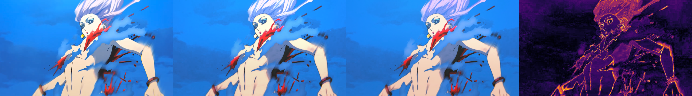
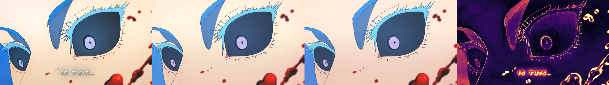

# Xenoz v1.1.1 — burn-safety regression report

## What changed
Original raw levels/matrix/shaper exceeded gamut; per-channel clipping flattened bright and saturated regions. The new grade uses a smooth, shared-RGB, source-anchored headroom limiter **before** hard clamp. USM now stays within its 25 source taps' extrema. Amount 1.1, gradient, flare, effect id/name and controls are unchanged. This is a conservative safety patch, not a new inferred colour grade.

The shader has always run USM before CC; reference code previously ran it after CC+gradient. Reference now matches the shader and uses pixel-centre positions and exact bilinear sampling. Consequently historical Python metrics are not directly interchangeable with the runtime baseline tested here.

## Measurement basis
Both original aligned 1280×720 copies versus edited frames. Existing bars, captions and invalid-border masks excluded. DE00/MAE on existing flat-interior mask intersected with valid mask; edge RMSE on existing edge mask intersected with valid mask; SSIM is mean luma SSIM map over valid pixels. No inputs or masks changed. Before/after results are **actual offscreen evaluations of the old/new shader**, not extrapolated values. Baseline source is git commit `3fb65ad`.

## Before → after
| Pair | Median DE00 ↓ | p90 DE00 ↓ | Mean RGB MAE /255 ↓ | Edge RMSE /255 ↓ | Luma SSIM ↑ | Valid pixels with any channel ≥254.5/255 ↓ |
|---|---:|---:|---:|---:|---:|---:|
| pairA | 1.409 → 1.502 | 3.398 → 5.089 | 4.226 → 5.179 | 20.184 → 20.269 | 0.9402 → 0.9512 | 17.8763% → 0.0146% |
| pairB | 3.261 → 4.166 | 6.093 → 7.075 | 5.314 → 6.406 | 34.457 → 34.590 | 0.9312 → 0.9404 | 22.9848% → 0.0005% |

**Tradeoff:** saturation/clipping incidence is substantially reduced and SSIM improves, but DE00/MAE and edge RMSE do not all improve. The edited targets themselves contain clipped highlights; avoiding those intentionally moves away from pixel-perfect target matching. An at-255 pixel may be legitimate source content, so this is a clipping proxy, not a count of proven damaged pixels. No claim that all user-visible burning is fixed until device testing.

Raw CC valid-region gamut excursions before clamp: A=37.4036%, B=64.1825%. Synthetic 33³ grid: 72.3794% previously outside gamut. Gamut safeguard output is finite/bounded on every sampled colour. The shared scale preserves the grading-displacement direction, not exact perceptual hue.

## Visual inspection
Layout: **edited target | previous shader | v1.1.1 shader | new absolute-error heatmap (5×, Inferno)**. Inputs are untouched. Both previews visually inspected.

## Tests
- GLSL ES 1.00 compile with temporary `#version 100`; no Keyflaw-only 1.4.9 features introduced.
- Offscreen OpenGL software renderer `llvmpipe (LLVM 20.1.2, 256 bits)`; GLSL syntax adapted only for desktop harness. This is **not a Keyflaw device test**.
- Complete 35,937-colour cube, all eight switch combinations, intensity=0 identity, alpha/premultiplication checks.
- Synthetic 0.2→0.8 steps at heights 409,720,1080: no new extrema.
- Full-frame shader/reference agreement: max difference A=0.1018, B=0.0923 levels/255, within 1/255.
- Detailed per-channel errors and test results: [validation.json](../analysis/outputs/burn_safety_v1.1.1/validation.json).
- Spec table / shader / JSON / LUT checks: `python owners/xenoz/analysis/src/verify_spec_parity.py`.
- Re-run runtime regressions: `python owners/xenoz/analysis/src/validate_burn_safety.py`.

## Releases and next step
Shared suite is now v1.1.1; pack `releases/MotionSalt_CC_v1.1.1.kfpack`. Floby source and packed bytes are unchanged. Original unversioned pack remains untouched and is archived byte-for-byte as `MotionSalt_CC_v1.1.0.kfpack`. New builds use an unused version in the filename and refuse overwrite. GitHub assets also have versioned filenames; prior releases/assets must never be deleted or replaced.

Import the **new versioned pack** in Keyflaw and test the clip that looked burnt, especially bright skin, sky and sharp outlines. If still wrong, compare Colour Correction / Quality / Haze Flare switches separately; no commands on the phone are required. This maintenance has not re-certified the initial fitting claims or proven temporal flicker absent.
