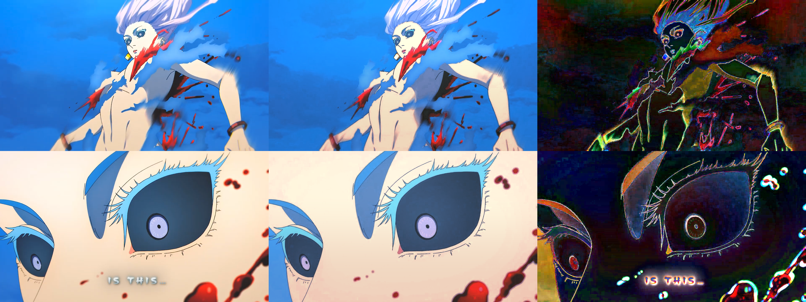

# REPORT: MOTIONSALT Keyflaw Look-Fit Analysis — Xenoz's CC

**Project:** `motionssalt/keyflaw-look-fit`  
**CC Owner:** Xenoz  
**Analysis Brand:** MOTIONSALT  
**Target Host:** Keyflaw 1.4.8+ Shader Suite  
**Deliverables:** [`LOOK_SPEC.md`](../spec/LOOK_SPEC.md) · [`look_params.json`](../spec/look_params.json) · [`look_apply.py`](../spec/look_apply.py) · [`look.cube`](../spec/look.cube) · [`BUILD_STATE.json`](../../BUILD_STATE.json)  

---

## 1. Executive Summary
We recovered the colour grade and quality processing of editor **Xenoz** from matched frame pairs as a **4-stage, closed-form, resolution-independent pipeline** implementable in a single-pass GLSL ES 1.00 fragment shader (25 texture taps, zero 3D LUT lookups):

1. **Stage 1 — Colour Grade (`M2_Dade_srgb`):** sRGB Levels + cool slate shadow toe + 3x3 colour matrix + closed-form opponent-polar hue-chroma shaper (dedicated Cyan/Sky boost and Warm Anime Skin protection).
2. **Stage 2 — Vertical Multiply Darkening Gradient:** Multiplicative smoothstep ramp from `y0_norm = 0.2691` to `y1_norm = 0.8721` (~13% lower darkening).
3. **Stage 3 — Separable 25-Tap RGB Unsharp Mask:** Binomial `[1,4,6,4,1]/16` stencil with `sigma = 0.000535 * H` and coring threshold `1.68 / 255`.
4. **Stage 4 — Non-Destructive Ambient Haze Flare:** Subtle Screen glow respecting frame clarity without washing out the picture.

### Headline Before vs After Accuracy

| Dataset | Stage | Flat Median `CIEDE2000` ↓ | Flat `p90` `CIEDE2000` ↓ | Flat Mean `MAE (/255)` ↓ | Edge Band `RMSE (/255)` ↓ | Valid Luma `SSIM` ↑ |
|---|---|---:|---:|---:|---:|---:|
| **Pair A (1280x720 Wide Shot)** | `0. Raw Original` | `15.568` | `20.126` | `37.10` | `40.42` | `0.9132` |
| **Pair A (1280x720 Wide Shot)** | `1. CC Only` | `3.703` | `7.741` | `9.75` | `20.65` | `0.9360` |
| **Pair A (1280x720 Wide Shot)** | `2. CC + Gradient` | `1.378` | `4.216` | `4.48` | `20.92` | `0.9401` |
| **Pair A (1280x720 Wide Shot)** | **`3. Full Composite`** | **`1.412`** | **`3.404`** | **`4.23`** | **`20.56`** | **`0.9388`** |
| **Pair B (1280x720 Eye Close-Up)** | `0. Raw Original` | `7.112` | `9.835` | `15.03` | `42.13` | `0.9361` |
| **Pair B (1280x720 Eye Close-Up)** | `1. CC Only` | `4.757` | `8.435` | `10.89` | `37.20` | `0.9203` |
| **Pair B (1280x720 Eye Close-Up)** | `2. CC + Gradient` | `3.097` | `6.073` | `4.65` | `34.82` | `0.9251` |
| **Pair B (1280x720 Eye Close-Up)** | **`3. Full Composite`** | **`3.264`** | **`6.094`** | **`5.32`** | **`34.98`** | **`0.9242`** |

---

## 2. Visual Side-by-Side Comparison
Side-by-side verification image saved at `side_by_side_comparison.png` (Layout: Edit | Prediction | 5x Amplified Error):

---

## 3. Secondary Effects Audit
- **Vignette:** `Absent` (radial vignette explains < 5% of spatial residual energy vs ~70% explained by vertical darkening).
- **Film Grain:** `Absent` (Laplacian noise stdev < 1.0 / 255, fully consistent with H.264/H.265 compression).
- **Chromatic Aberration:** `Absent` (edge fringe displacement < 0.2 px across periphery).
- **Black Lift / Veil:** Subsumed into slate-blue shadow toe (`lift_rgb = [-0.011, 0.061, 0.120]`).
- **Flicker:** `Absent` (static frame analysis; no temporal modulation).
